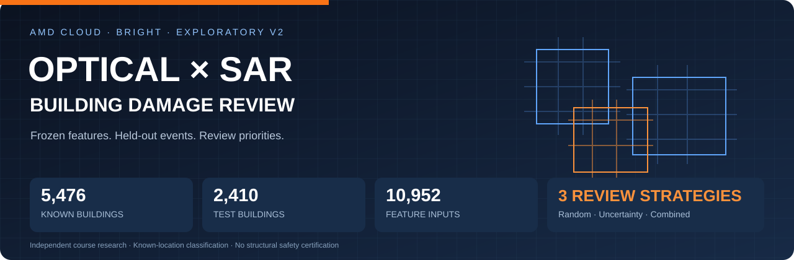
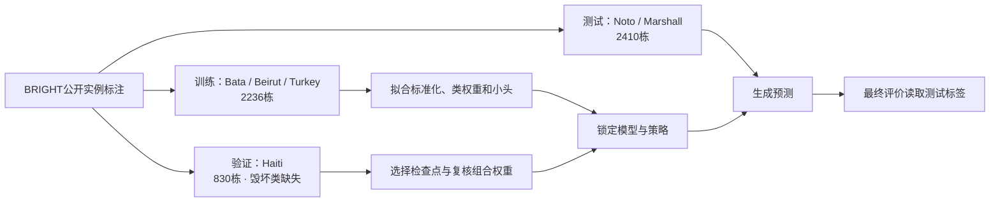
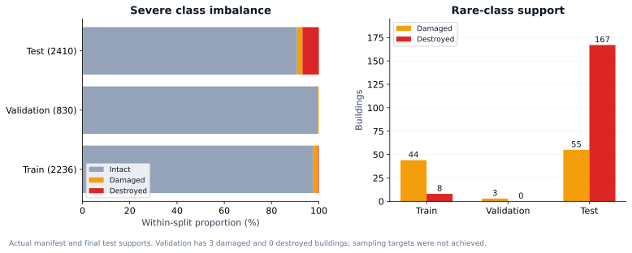
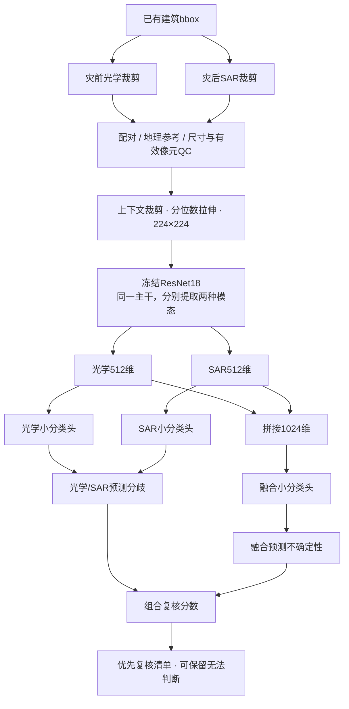
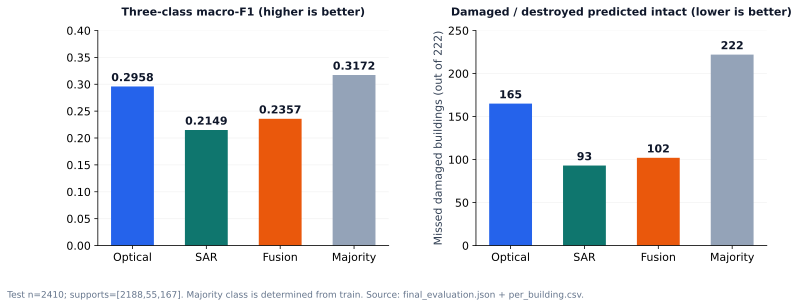
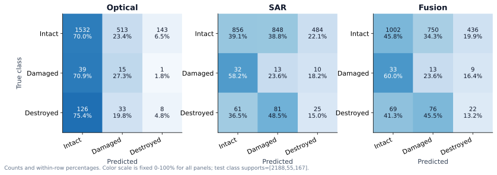
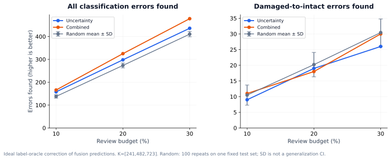
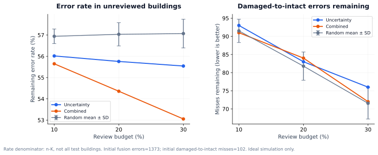

# AMD 云端光学–SAR 建筑损毁识别与人工复核



<p align="center">
  
  
  
  
  
</p>

<p align="center"><b>灾前光学 × 灾后 SAR · 冻结视觉特征 · 跨事件分类 · 人工复核优先级</b></p>

> **研究问题：** 当灾后影像中的识别结果存在错误时，光学与 SAR 融合是否改善分类？有限的人工复核应优先查看哪些建筑？本项目同时报告分类、一般错误捕获和损毁漏判，保留真实负结果。

**交付入口：** [固定版本与权重](https://github.com/cool6boy/amd-optical-sar-damage-review/releases/tag/v0.2.0-course) · [完整产物索引](docs/ARTIFACTS.md) · [任务流程详解](docs/PROJECT_FLOW.md) · [数字失败案例](docs/FAILURE_CASES.md)

**阅读导航：** [研究结论](#研究结论) · [数据与划分](#数据与划分) · [方法](#方法) · [分类结果](#分类结果) · [复核实验](#复核实验) · [复现](#复现) · [证据与局限](#证据与局限)

---

## 研究结论

| 观察 | 本次实验的证据 | 可以得出的结论 |
|---|---|---|
| 融合没有稳定优于单模态 | optical / SAR / fusion macro-F1 = **0.2958 / 0.2149 / 0.2357** | 简单特征拼接在这批跨事件样本中未超过光学基线 |
| 分类分数与漏判风险需要共同考察 | 光学漏判损毁 **165/222**；SAR **93/222**；融合 **102/222** | 分数较高的模型仍可能漏掉更多受损建筑 |
| 组合排序能捕获更多一般分类错误 | 复核30%时，组合排序发现 **478** 个错误；随机均值 **410.24** | 此预算下，相对随机的一般错误捕获增加约 **16.5%** |
| 损毁漏判的复核收益有限 | 同预算找到损毁漏判：组合 **30**；随机 **30.44 ± 4.33** | 一般错误捕获增加，尚未体现损毁漏判捕获优于随机 |
| 数据和验证覆盖影响结论 | 训练毁坏仅 **8** 栋；验证仅 **3** 栋受损、**0** 栋毁坏 | 当前属于探索性课程实验，不适合部署性或结构安全结论 |

**额外对照：** 使用训练集多数类确定的“全部预测完整”基线，测试 accuracy 为 **90.79%**、三类 macro-F1 为 **0.3172**，但会漏掉全部 **222** 栋损毁建筑。该基线的宏F1也高于本次三个学习模型，进一步说明当前分类效果有限；不能仅用accuracy包装模型表现。

## 项目概览

| 项目 | 已交接的最终结果 |
|---|---|
| 总建筑数 | **5,476** |
| 训练 / 验证 / 测试 | **2,236 / 830 / 2,410** |
| 双模态输入 / 完成标记特征数 | **10,952** |
| 类别 | 0 完整（intact）；1 受损（damaged）；2 毁坏（destroyed） |
| 主干 | torchvision ResNet18，ImageNet1K V1，冻结参数 |
| 分类器 | 单模态512维 / 融合1024维线性小头；固定3个seed的概率平均 |
| 复核策略 | 随机、不确定性、不确定性与模态分歧组合 |
| 云端环境 | Radeon 8060S Graphics · PyTorch 2.9.1+rocm7.13.0 |
| 性质 | 已知建筑位置条件下的分类与理想复核模拟 |

**范围：** 建筑位置或外接框来自已有标注。项目没有完成整幅影像的建筑自动检测；影像分类不能替代现场结构安全鉴定。光学影像来自**灾前**，其基线可能利用建筑外观和区域背景等信息，不能解释为直接看到了灾后光学损毁。

## 数据与划分

数据来自 [BRIGHT官方数据源](https://huggingface.co/datasets/Kullervo/BRIGHT)，固定revision：

```text
46f202d9520cb0844a6ca4679d016d0d27a6d58c
```

采用公开实例标注构建自定义课程划分；以下结果**不是BRIGHT官方竞赛排行榜成绩**。

| 集合 | 事件 | 建筑数 | 完整 | 受损 | 毁坏 |
|---|---|---:|---:|---:|---:|
| Train | Bata explosion / Beirut explosion / Turkey earthquake | 2,236 | 2,184 | 44 | 8 |
| Validation | Haiti earthquake | 830 | 827 | 3 | 0 |
| Test | Noto earthquake / Marshall wildfire | 2,410 | 2,188 | 55 | 167 |
| **Total** | **6个事件，按事件隔离** | **5,476** | **5,199** | **102** | **175** |

测试事件分别包含 Noto **780** 栋、Marshall **1,630** 栋。训练、验证和测试事件互不重叠；manifest中测试label为null，预测与最终评价产物分开。



**关于计划与实际：** 历史交接文字仍出现3771栋的中间数量，最终manifest与评价文件为5476栋。配置中的部分目标字段（如每事件测试400栋）未由当前准备实现完整执行，因此实际测试量超出早期目标；主页以实际统计为准，并在[审计说明](docs/AUDIT.md)公开偏差，不将计划目标描述为已达成。



## 方法



### 为什么采用冻结特征

- 两种模态共用一种小型预训练主干，各自前向计算得到特征。
- 特征以输入内容、权重和预处理指纹缓存；后续单模态、融合、小头多seed及排序实验复用缓存。
- ResNet18主干冻结，只优化线性分类头，减少重复的大模型计算。
- 数据采用HTTP Range读取所选ZIP成员，拒绝服务端忽略Range时退回完整大包下载。

这里使用的是通用ImageNet主干，并非专用SAR预训练模型。SAR分布、显示拉伸和模态差异是本研究的重要限制。

### 训练与策略参数

| 参数 | 实际锁定配置 |
|---|---|
| 小头优化器 | AdamW |
| Epoch上限 / 学习率 / weight decay | 60 / 0.01 / 0.01 |
| Ensemble seeds | 11、23、47 |
| 类别权重 | 仅从训练集计数计算的逆频率权重 |
| 标准化 | 仅使用训练集均值和标准差 |
| 检查点选择 | 验证集交叉熵最优 |
| 组合权重候选 | 0.25、0.50、0.75 |
| 最终组合权重 | **alpha = 0.25**，用验证集选择 |
| 随机复核 | 固定100次随机种子重复 |
| 测试分类决策 | 三分类argmax，评价后不据此调参 |

复核分数为：

```text
U = H(p_fusion) / log(3)
D = JSD(p_optical, p_sar) / log(2)
combined_score = 0.25 × U + 0.75 × D
```

分歧具体指**光学与SAR分类器预测分布的差异**，不是重复训练多个大型主干。排序不接收测试标签。

## 分类结果





测试集 **n=2410**，其中损毁（受损+毁坏）**222** 栋。下面所有数值来自最终评价与逐建筑CSV，可复核。

| 输入 | 三类macro-F1 ↑ | 完整召回 ↑ | 受损召回 ↑ | 毁坏召回 ↑ | 损毁判完整 ↓ |
|---|---:|---:|---:|---:|---:|
| Optical | **0.2958** | 70.02% | **27.27%** | 4.79% | 165 / 222（74.32%） |
| SAR | 0.2149 | 39.12% | 23.64% | **14.97%** | **93 / 222（41.89%）** |
| Fusion | 0.2357 | 45.80% | 23.64% | 13.17% | 102 / 222（45.95%） |
| 训练多数类恒预测 | 0.3172 | 100.00% | 0.00% | 0.00% | 222 / 222（100.00%） |

<details>
<summary><b>展开三组原始混淆矩阵</b>（行=真值，列=预测；顺序完整/受损/毁坏）</summary>

| Optical | 预测完整 | 预测受损 | 预测毁坏 |
|---|---:|---:|---:|
| 真值完整 | 1532 | 513 | 143 |
| 真值受损 | 39 | 15 | 1 |
| 真值毁坏 | 126 | 33 | 8 |

| SAR | 预测完整 | 预测受损 | 预测毁坏 |
|---|---:|---:|---:|
| 真值完整 | 856 | 848 | 484 |
| 真值受损 | 32 | 13 | 10 |
| 真值毁坏 | 61 | 81 | 25 |

| Fusion | 预测完整 | 预测受损 | 预测毁坏 |
|---|---:|---:|---:|
| 真值完整 | 1002 | 750 | 436 |
| 真值受损 | 33 | 13 | 9 |
| 真值毁坏 | 69 | 76 | 22 |

</details>

### 辅助分析：完整 / 损毁

将同一三分类argmax预测和真值中的受损、毁坏合并。这是发布整理阶段从既有结果派生的描述性分析，**没有另训二分类模型，也不声称是已预注册的新主实验**。

| 输入 | 损毁召回 ↑ | 损毁precision ↑ | 损毁F1 ↑ |
|---|---:|---:|---:|
| Optical | 25.68% | 7.99% | 0.1219 |
| SAR | **58.11%** | 8.83% | 0.1533 |
| Fusion | 54.05% | **9.19%** | **0.1571** |

误报很多、毁坏类召回偏低，表明这套简洁基线仍有明显不足。辅助指标不能替代原三分类报告。

## 复核实验





**设置：** 对融合模型固定同一批预测，用不同排序选取相同数量的建筑。选中的错误假设由已有标签正确纠正，属于**理想复核模拟**，不等于真人审核准确率、耗时或生产收益。

### 相同预算找到多少一般分类错误

| 复核比例 | 实际K | 随机，均值 ± 标准差 | 不确定性 | 组合排序 |
|---|---:|---:|---:|---:|
| 10% | 241 | 137.96 ± 7.45 | 158 | **166** |
| 20% | 482 | 273.37 ± 10.52 | 298 | **325** |
| 30% | 723 | 410.24 ± 11.37 | 436 | **478** |

融合模型原有分类错误 **1373** 个。30%组合复核捕获其中 **34.81%**，仍有 **895** 个错误未复核。

### 对危险漏判是否同样有效

“损毁漏判”定义为真值受损或毁坏、预测完整。融合模型原有此类错误 **102** 个。

| 复核比例 | 随机找到漏判，均值 ± 标准差 | 不确定性找到 | 组合找到 | 组合后剩余 |
|---|---:|---:|---:|---:|
| 10% | 10.49 ± 3.20 | 9 | 11 | 91 |
| 20% | 20.21 ± 3.89 | 19 | 18 | 84 |
| 30% | 30.44 ± 4.33 | 26 | 30 | 72 |

30%预算下组合策略找到更多一般错误，但找到的损毁漏判与随机均值近似。**排序优化目标需要与实际风险目标对齐。** 不能用一般错误捕获率的增加，宣称实现了更安全的灾后决策。

### 剩余未复核结果的错误率

分母为**未复核建筑数量 n−K**，不是全体测试建筑。

| 比例 | 随机均值 | 不确定性 | 组合 |
|---|---:|---:|---:|
| 10% | 56.94% | 56.02% | **55.65%** |
| 20% | 57.03% | 55.76% | **54.36%** |
| 30% | 57.07% | 55.54% | **53.05%** |

随机标准差只反映该固定测试集的抽样波动，不是跨事件泛化置信区间。没有据此进行统计显著性或现场安全承诺。

## AMD 云端环境

| 字段 | 交接包记录 |
|---|---|
| GPU | AMD Radeon 8060S Graphics |
| Python | 3.12.3 |
| PyTorch | 2.9.1+rocm7.13.0 |
| TorchVision | 0.24.0+rocm7.13.0 |
| HIP | 7.13.99004-3309c6114a |
| GPU available | true |
| 环境记录时间 | 2026-10-25 05:32:32 UTC |

这些字段来自运行生成的environment.json。主机有GPU不代表每个步骤都用GPU：冻结特征提取使用ROCm，源码中的小头训练使用CPU张量。运行记录也不能替代AUP实际Usage账单或Stopped确认；本项目不提供未经核验的费用和GPU总耗时结论。

## 复现

### 1. 先复核公开结果

无需GPU、原始影像或PyTorch，优先查看：

- [完整实验结果](docs/RESULTS.md)
- [数据、指标和哈希审计](docs/AUDIT.md)
- [数据说明与实际划分](docs/DATA_CARD.md)
- [限制与计划执行偏差](docs/LIMITATIONS.md)
- [已交接原始最终评价](results/run/final_evaluation.json)
- [逐建筑结果](results/run/per_building.csv)

### 2. 在AMD云端重新运行

以下为Linux云端重建路径。原始数据、全部裁剪、NPZ缓存及第三方主干权重不随仓库分发，需按[复现说明](docs/REPRODUCE.md)重新准备。

```bash
git clone https://github.com/cool6boy/amd-optical-sar-damage-review.git
cd amd-optical-sar-damage-review

# 保留平台已有ROCm torch/torchvision，仅补齐轻量数据依赖
python -m pip install -r requirements-cloud.txt

export ADR_ROOT=/home/jovyan/adr-reproduce-v2
export TORCH_HOME="$ADR_ROOT/cache/torch"
export XDG_CACHE_HOME="$ADR_ROOT/cache"

python -m adr.prepare --root "$ADR_ROOT" \
  --config configs/formal-v2.lock.json --cloud-confirm

python -m adr.pipeline weights --root "$ADR_ROOT" \
  --config configs/formal-v2.lock.json --cloud-confirm
```

GPU提取前必须按真实平台会话登记运行凭据；后续每条命令均显式指定v2配置，避免默认pilot。详见[逐步复现与设备要求](docs/REPRODUCE.md)。README命令提供运行入口，发布整理阶段没有重新下载数据或训练整个实验。

### 3. 复核界面

```bash
python -m adr.viewer --root "$ADR_ROOT" --port 8765
```

界面只绑定127.0.0.1，在AUP内通过授权代理或Ports打开。支持完整、受损、毁坏和无法判断；人工记录与测试标签分开保存。交接包未包含真人判读记录及全部裁剪，因此本仓库**没有实测真人复核收益**，下载源码后也不会凭空拥有完整在线图片演示。

## 证据与局限

发布整理时完成了 **17项文件哈希关联及混淆矩阵一致性检查**，全部通过：

- 准备、特征、模型策略关联到同一manifest和配置；
- heads.pt指纹与policy一致；
- 预测、policy、最终评价和逐建筑CSV的哈希关联一致；
- 从2410行CSV重算的三组混淆矩阵与最终报告一致。

另外，发布版本的 **31项轻量测试** 及标准库结果脚本 **90项复核** 均通过；后者包括100次随机基线的重新计算。测试临时目录已作跨平台修正，未重训或修改原预测。

**验证边界：** 特征NPZ与完整裁剪未交接，因此无法在发布端重新检查每份特征内容或完整重跑训练；这些文件的存在与计算事实依赖云端交接凭据。文件哈希一致也不能独立证明所有操作的时间顺序。

必须保留的限制：

1. 训练严重不均衡：毁坏类仅8栋，验证无毁坏、仅3栋受损。
2. 验证交叉熵与排序选择可能被完整类主导。
3. 通用ImageNet特征对SAR和跨事件域差异适配有限。
4. 建筑属于相关影像片，不能把每栋看作独立灾害事件证据。
5. 原计划目标字段与实际准备实现存在偏差，未用事后删样本掩盖。
6. 无真人复核实验、现场核验和部署测试。
7. 不包含真正的测试失败案例影像；现有训练预检图不能冒充失败案例。

## 许可与引用

- 原创代码采用 [MIT](LICENSE)。
- BRIGHT影像、标签和派生材料保留各自原许可；多数Maxar光学及对应标签为CC BY-NC 4.0，SAR为CC BY 4.0，具体以官方事件来源为准。
- 第三方预训练ResNet18权重不重新分发。
- 自训小头及结果的许可边界见[模型说明](docs/MODEL_CARD.md)与[第三方来源](THIRD_PARTY.md)；不要把代码MIT理解为所有数据、模型素材均可商业使用。

参考：Chen et al. **BRIGHT: a globally distributed multimodal building damage assessment dataset with very-high-resolution for all-weather disaster response.** Earth System Science Data, 17, 2025. DOI: [10.5194/essd-17-6217-2025](https://doi.org/10.5194/essd-17-6217-2025)。

---

**课程研究的价值：** 通过真实AMD云端计算，展示数据不均衡、模态差异、评价目标与人工复核优先级之间的关系。完整公开负结果与证据边界，是这次实验交付的一部分。
